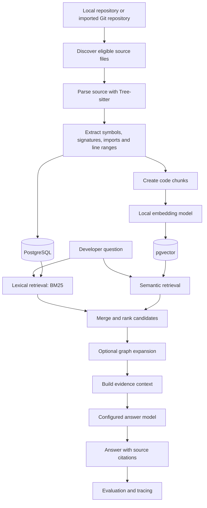
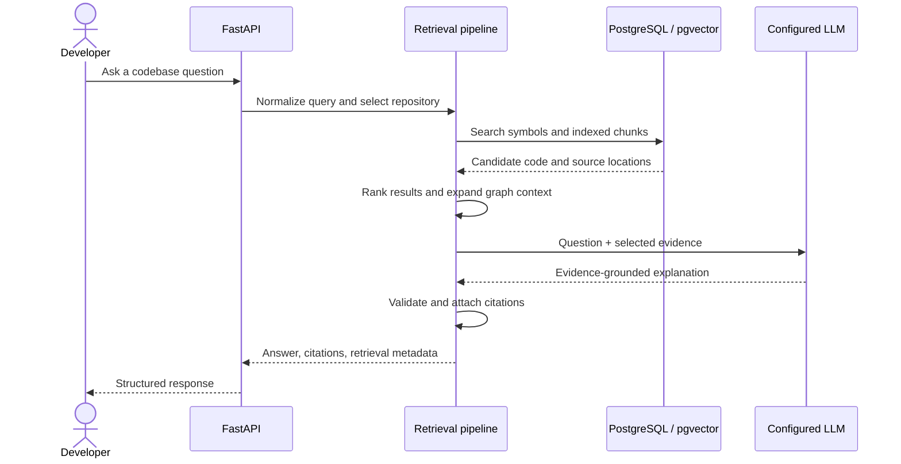
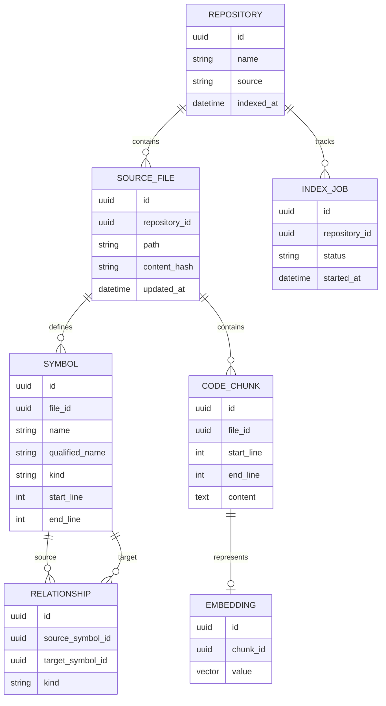
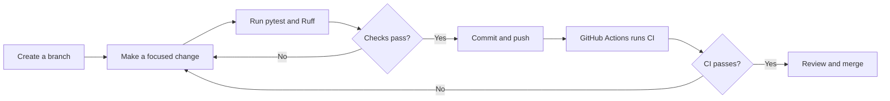
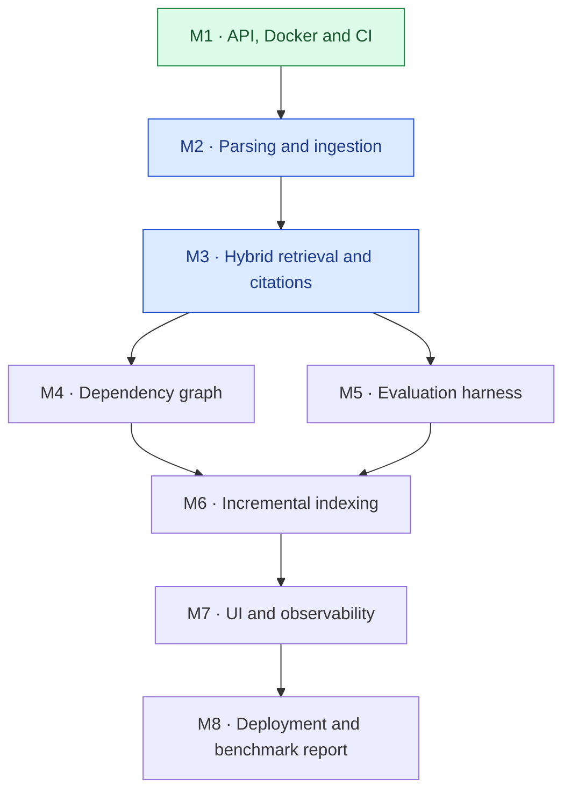

# RepoMind

```{=html}
<p align="center">
```
`<strong>`{=html}Understand any codebase. Trace the logic. Trust the
evidence.`</strong>`{=html}
```{=html}
</p>
```
```{=html}
<p align="center">
```
An AST-aware code intelligence platform with hybrid retrieval,
dependency graphs, source-grounded answers, and an evaluation harness.
```{=html}
</p>
```
```{=html}
<p align="center">
```
`<a href="https://github.com/Ankitpatil944/RepoMind/actions">`{=html}``{=html}`</a>`{=html}
``{=html}
``{=html}
``{=html}
``{=html}
```{=html}
</p>
```
> **Project status:** Early development. The initial API, health
> endpoint, Docker setup, and CI workflow form the foundation.
> Repository ingestion, hybrid retrieval, graph analysis, evaluation,
> and UI are planned milestones and should not be considered complete
> until implemented and tested.

------------------------------------------------------------------------

## Contents

-   [Why RepoMind?](#why-repomind)
-   [Project goals](#project-goals)
-   [How it works](#how-it-works)
-   [Architecture](#architecture)
-   [Planned capabilities](#planned-capabilities)
-   [Technology stack](#technology-stack)
-   [Current status](#current-status)
-   [Getting started](#getting-started)
-   [API](#api)
-   [Configuration](#configuration)
-   [Development workflow](#development-workflow)
-   [Testing and evaluation](#testing-and-evaluation)
-   [Security principles](#security-principles)
-   [Roadmap](#roadmap)
-   [Design decisions](#design-decisions)
-   [Contributing](#contributing)
-   [License](#license)

## Why RepoMind?

Large codebases are difficult to understand. A developer joining an
unfamiliar project often needs to answer questions such as:

-   Where is authentication implemented?
-   Which API endpoint calls this function?
-   What modules depend on this class?
-   Which tests cover this behavior?
-   What might be affected if I change this method?
-   Where does a request flow from the API layer to the database?

A conventional text-only code chatbot can retrieve a vaguely related
snippet and generate a plausible explanation without reliably
understanding code structure. RepoMind is designed to improve that
workflow by combining **syntax-aware indexing, lexical and semantic
retrieval, explicit code relationships, and source citations**.

The central principle is simple:

> Answers should be grounded in the repository, point to inspectable
> evidence, and be evaluated against known questions instead of judged
> only by how convincing they sound.

## Project goals

1.  **Understand code structure.** Parse supported languages into
    functions, classes, imports, and source locations.
2.  **Retrieve relevant evidence.** Combine exact-term matching with
    semantic similarity and reranking.
3.  **Trace relationships.** Build a graph of imports, calls, routes,
    and other useful dependencies where they can be resolved.
4.  **Explain with citations.** Return file paths and line ranges so
    developers can verify answers.
5.  **Measure quality.** Maintain a repeatable evaluation set for
    retrieval quality, answer faithfulness, and latency.
6.  **Re-index efficiently.** Update only files affected by repository
    changes.
7.  **Run reproducibly.** Use containers and automated checks so
    development is consistent across machines.

## How it works

The intended end-to-end workflow is:



*This diagram describes the target architecture. Components shown beyond
the implemented foundation are planned and may change as the project
evolves.*

### Example question flow



*The sequence is the intended flow for the future question-answering
feature, not a claim that `/ask` is currently implemented.*

## Architecture

### Core layers

  -----------------------------------------------------------------------
  Layer                   Responsibility          Planned implementation
  ----------------------- ----------------------- -----------------------
  API                     HTTP interface, request FastAPI
                          validation, response    
                          schemas                 

  Ingestion               File discovery,         Tree-sitter and Python
                          parsing, symbol         services
                          extraction, incremental 
                          updates                 

  Structured storage      Repository metadata,    PostgreSQL
                          files, symbols,         
                          relationships, job      
                          state                   

  Vector retrieval        Embedding storage and   pgvector
                          similarity search       

  Lexical retrieval       Exact identifier and    PostgreSQL full-text
                          keyword search          search and/or BM25

  Reranking               Improve ordering of     Local
                          retrieved candidates    sentence-transformers
                                                  model

  Code graph              Represent imports,      Relational graph tables
                          calls, routes, and      initially
                          dependencies            

  Answer generation       Explain retrieved code  Optional configurable
                          and provide citations   model backend

  Evaluation              Golden datasets,        Python CLI and CI
                          metrics, regression     
                          thresholds              

  Background work         Run expensive indexing  Celery or ARQ if
                          outside request         justified
                          handling                

  Observability           Latency, errors,        OpenTelemetry and/or an
                          tracing, model usage    LLM tracing tool

  Interface               Repository selection,   UI choice to be
                          question input, source  finalized
                          navigation              
  -----------------------------------------------------------------------

### Proposed data model

The exact schema will be established during implementation and migration
design. The logical entities are expected to include:



This is a conceptual diagram, not a finalized database migration. Actual
field types, keys, constraints, vector dimensions, and relationship
rules must match the implemented schema.

## Planned capabilities

### 1. AST-aware repository ingestion

-   Accept an explicitly permitted local repository path or a supported
    Git source.
-   Discover eligible source files without executing repository code.
-   Parse supported languages using Tree-sitter.
-   Extract classes, functions, qualified names when resolvable,
    signatures where available, imports, and exact one-based line
    ranges.
-   Track file hashes to identify content changes.
-   Remove stale symbols when files are deleted or changed.
-   Exclude `.git`, virtual environments, generated artifacts, and
    configured ignored paths.

Initial language support is planned for Python and JavaScript. Support
should be declared per parser and tested rather than assumed.

### 2. Hybrid retrieval

The intended retrieval pipeline combines complementary approaches:

-   **Lexical search:** strong for exact identifiers, filenames, error
    messages, and symbols.
-   **Semantic search:** finds conceptually related code even when the
    wording differs.
-   **Candidate fusion:** combines result lists from different
    retrievers.
-   **Reranking:** uses a local cross-encoder or other selected reranker
    to improve relevance.
-   **Context expansion:** follows relevant code relationships when that
    helps answer the question.
-   **Citation handling:** preserves file paths and source line ranges
    through the full pipeline.

Retrieval quality depends on parsing, chunking, embedding selection,
ranking, and query formulation. No single retrieval technique is
expected to solve every question.

### 3. Code graph and route detection

The graph is intended to represent relationships such as:

-   A module imports another module.
-   A function calls another function.
-   A file defines a class or function.
-   A route maps to a handler.
-   A component depends on another component.

Framework-aware extraction can help answer questions such as "Which API
endpoints handle login?" Static analysis cannot resolve every dynamic
call. RepoMind should record unresolved relationships and distinguish
direct evidence from inferred relationships.

### 4. Evaluation harness

The evaluation harness is intended to make changes measurable.

A dataset entry may include:

-   A question.
-   The repository and revision being evaluated.
-   Expected relevant symbols or source ranges.
-   Optional expected answer facts.
-   Evaluation metadata and tags.

Planned metrics:

  -----------------------------------------------------------------------
  Metric                              What it measures
  ----------------------------------- -----------------------------------
  Recall@k                            Whether expected evidence appears
                                      among the top *k* retrieved results

  MRR / ranking metrics               How highly the first relevant
                                      result is ranked

  Answer faithfulness                 Whether answer claims are supported
                                      by retrieved evidence

  Citation accuracy                   Whether cited paths and line ranges
                                      identify the supporting source

  Latency                             Time spent retrieving and
                                      generating an answer

  Cost / resource usage               API spending when hosted models are
                                      enabled, plus local resource
                                      measurements where useful
  -----------------------------------------------------------------------

The exact metrics and thresholds should be documented alongside the
dataset. LLM-as-judge scores should not be treated as ground truth
without validation.

### 5. Incremental indexing

The target design uses file hashes and/or Git change information to
re-index changed files instead of processing the entire repository every
time. It must correctly handle added, modified, deleted, and renamed
files, retries, interrupted jobs, and concurrent indexing attempts.

### 6. Observability and user interface

Later milestones may add tracing, structured logs, latency measurements,
caching, and a lightweight UI. These should help users inspect retrieved
evidence and help maintainers diagnose slow or incorrect results.

## Technology stack

  -----------------------------------------------------------------------
  Technology                          Role
  ----------------------------------- -----------------------------------
  Python                              Application and indexing logic

  FastAPI                             HTTP API

  PostgreSQL                          Structured persistence

  pgvector                            Vector similarity search

  Tree-sitter                         Source-code parsing

  BM25 / PostgreSQL text search       Lexical retrieval

  sentence-transformers               Local embedding or reranking
                                      models, selected per component

  Local model runtime or optional     Answer generation
  hosted LLM                          

  Docker Compose                      Local multi-service development

  pytest                              Automated tests

  Ruff                                Linting and formatting checks

  GitHub Actions                      Continuous integration

  Celery or ARQ                       Optional background jobs when
                                      needed

  OpenTelemetry / optional LLM        Observability
  tracing                             
  -----------------------------------------------------------------------

### Local-first and cost-conscious design

The project aims to support a local workflow without requiring paid
services for core development. Hosted model integrations may be
optional.

The selected embedding model, answer model, and reranker are separate
decisions. They have different compute, memory, quality, and latency
requirements. Do not assume that choosing a local LLM automatically
makes every component local.

## Current status

The project is being built in milestones. Update this section as
features are implemented and verified.

  -----------------------------------------------------------------------
  Milestone               Scope                   Status
  ----------------------- ----------------------- -----------------------
  1                       FastAPI skeleton,       Foundation reported
                          health endpoint,        implemented; CI failure
                          PostgreSQL + pgvector   needs to be resolved
                          Docker setup, initial   and re-verified
                          CI                      

  2                       Tree-sitter ingestion   Planned / in progress
                          and symbol search       

  3                       Hybrid retrieval,       Planned
                          reranking, `/ask`,      
                          citations               

  4                       Call/import graph and   Planned
                          endpoint detection      

  5                       Golden dataset and      Planned
                          evaluation regression   
                          gate                    

  6                       Incremental indexing    Planned

  7                       Observability and UI    Planned

  8                       Deployment,             Planned
                          documentation, and      
                          benchmark results       
  -----------------------------------------------------------------------

Do not mark a milestone complete until its acceptance checks pass.

## Getting started

### Prerequisites

Install the following before starting local development:

-   Git
-   Python 3.12 or the version pinned by the project
-   Docker Desktop with Docker Compose support
-   A terminal such as PowerShell on Windows

### 1. Clone the repository

``` powershell
git clone https://github.com/Ankitpatil944/RepoMind.git
cd RepoMind
```

### 2. Start the services

From the directory containing `docker-compose.yml`:

``` powershell
docker compose up --build
```

Run in the background if desired:

``` powershell
docker compose up --build -d
```

Check service status:

``` powershell
docker compose ps
```

View logs:

``` powershell
docker compose logs -f api
docker compose logs -f db
```

Service names such as `api` and `db` must match the actual Compose file.
If they differ, use the names shown by `docker compose ps`.

### 3. Check the health endpoint

Open the following URL in a browser:

``` text
http://localhost:8000/health
```

Or call it from PowerShell:

``` powershell
Invoke-RestMethod http://localhost:8000/health
```

The initial health endpoint is expected to return a successful response,
commonly `{"status":"ok"}` or the response defined in `app/main.py`.
Check the actual implementation for the exact response shape.

If the service is not available, inspect the API logs and confirm that
the port mapping in `docker-compose.yml` exposes port `8000`.

### 4. Run tests locally

Create and activate a virtual environment if you are running the Python
checks outside Docker:

``` powershell
py -3.12 -m venv .venv
.\.venv\Scripts\Activate.ps1
python -m pip install --upgrade pip
pip install -r requirements.txt
```

Run the tests and lint checks:

``` powershell
python -m pytest -q
python -m ruff check .
```

If the project adds separate development dependencies or formatting
checks, install and run those as documented by the relevant
configuration files.

### 5. Stop the services

``` powershell
docker compose down
```

To also remove the Compose-managed database volume, which deletes its
persisted data:

``` powershell
docker compose down -v
```

**Warning:** `-v` deletes the volumes associated with this Compose
project. Do not use it if you need to preserve your local database.

## API

### Implemented foundation

  Method   Endpoint    Purpose
  -------- ----------- ------------------------
  `GET`    `/health`   Basic API health check

The exact response is defined by the current implementation. Additional
endpoints should be documented here when they exist and have tests.

### Planned endpoints

These are target API contracts, not promises that the endpoints
currently exist.

  ------------------------------------------------------------------------------
  Method                  Endpoint                       Intended purpose
  ----------------------- ------------------------------ -----------------------
  `POST`                  `/repositories`                Register or submit a
                                                         repository for indexing

  `POST`                  `/repositories/{id}/index`     Start or request
                                                         indexing

  `GET`                   `/repositories/{id}/symbols`   Search or list
                                                         extracted symbols

  `GET`                   `/repositories/{id}/graph`     Inspect code
                                                         relationships

  `POST`                  `/repositories/{id}/ask`       Ask a question and
                                                         receive a grounded
                                                         answer

  `GET`                   `/jobs/{id}`                   Inspect indexing job
                                                         status
  ------------------------------------------------------------------------------

Request schemas, response examples, authentication, pagination, error
handling, and status codes should be added once the contracts are
implemented. The FastAPI interactive documentation is typically
available at `http://localhost:8000/docs` while the service is running.

## Configuration

Use environment variables for configuration and secrets. A future
`.env.example` should document non-secret defaults such as database
connection settings, model selection, permitted repository roots, and
retrieval limits.

Do not commit real API keys, passwords, tokens, or production
credentials. If a hosted LLM is enabled, its API key should be supplied
through the runtime environment or an appropriate secret manager.

Configuration names must match the actual application. Do not copy
placeholder variable names into production until they are implemented.

## Development workflow

A typical development loop is:



Suggested commands:

``` powershell
git switch -c feat/symbol-indexer
python -m pytest -q
python -m ruff check .
git status
git add .
git commit -m "feat: add symbol indexing"
git push -u origin feat/symbol-indexer
```

Use a branch name and commit message appropriate to the change. Review
`git status` before committing to avoid accidentally including generated
files, local databases, virtual environments, or secrets.

### Continuous integration

The GitHub Actions workflow is intended to run linting and tests on
pushes and pull requests. A green workflow indicates that the configured
checks passed for that commit; it does not prove the application is
secure, correct for every repository, or deployed.

CI should eventually test database-backed integration paths in a
reproducible environment. Keep dependency versions and supported Python
versions explicit.

## Testing and evaluation

RepoMind has two distinct verification layers:

**Software tests** - Unit tests for parsing, chunking, path filtering,
and symbol extraction. - Database integration tests for persistence and
indexing idempotency. - API tests for request validation and response
schemas. - Regression tests for deleted, modified, and renamed files. -
Security tests for repository path restrictions and untrusted source
files.

**Retrieval and answer evaluations** - Golden questions tied to known
source evidence. - Retrieval Recall@k and ranking metrics. - Citation
path and line-range validation. - Answer faithfulness checks. - Latency
and resource measurements. - CI thresholds to catch regressions.

A passing unit test suite does not automatically imply high retrieval
quality. Both layers need their own tests and reports.

## Security principles

Repositories may contain untrusted code and sensitive information.
Security must be designed into ingestion and API boundaries.

-   Never execute source files, package scripts, Git hooks, or build
    commands from an indexed repository.
-   Restrict indexing to explicitly approved local roots or controlled
    repository sources.
-   Resolve and validate paths to prevent traversal outside approved
    directories.
-   Treat source content, filenames, comments, and repository
    instructions as untrusted data.
-   Do not allow repository content to override system instructions or
    tool permissions.
-   Avoid exposing arbitrary filesystem access through the API.
-   Set file-size, repository-size, and processing-time limits.
-   Avoid logging secrets or complete source files unnecessarily.
-   Keep database credentials and model API keys out of source control.
-   Validate uploaded or supplied Git sources and use safe subprocess
    practices if Git operations are introduced.
-   Add authentication and authorization before exposing a multi-user or
    public deployment.

These are design requirements. They should be backed by implementation
and security tests, not just documentation.

## Roadmap



### Acceptance criteria

A milestone is ready to be considered complete only when its core
behavior is demonstrated:

-   **Ingestion:** index a known sample repository and retrieve symbols
    with correct one-based line ranges.
-   **Retrieval:** answer a question using relevant code and citations
    that resolve to the indexed revision.
-   **Graph:** trace at least a tested route-to-handler or import/call
    relationship.
-   **Evaluation:** run a reproducible golden dataset and fail CI when a
    configured threshold is missed.
-   **Incremental indexing:** modify and delete files, re-index, and
    verify that the database contains no stale records.
-   **Deployment:** follow the README on a clean environment and
    reproduce the demo.

## Design decisions

### Why AST-aware chunks instead of arbitrary text chunks?

Functions and classes are meaningful code units. AST-aware chunking can
preserve symbol names and line ranges, making retrieval and citations
more useful. Some files still require fallback chunking when parsing
fails or a symbol is unusually large.

### Why combine lexical and semantic retrieval?

Developers frequently search for exact identifiers, but they also ask
conceptual questions. Lexical retrieval handles exact matches well,
while embeddings help with conceptual similarity. Hybrid retrieval aims
to capture both strengths.

### Why keep an evaluation harness in the project?

Retrieval and generation can regress silently when chunking, prompts,
models, or ranking change. A versioned dataset and repeatable metrics
make tradeoffs visible and help prevent a demo from appearing successful
only on hand-picked examples.

### Why PostgreSQL and pgvector?

A relational database can store repository metadata, symbols, jobs, and
relationships while pgvector supports vector similarity search in the
same database. This reduces the number of services needed for an initial
version. Whether that remains the best choice should be validated
against workload and scale requirements.

## Contributing

Contributions and technical feedback are welcome.

1.  Open an issue describing the problem or proposed improvement.
2.  Keep changes focused and include tests for new behavior.
3.  Run pytest and Ruff locally.
4.  Avoid adding paid-service dependencies without discussing the
    tradeoff.
5.  Update documentation when API contracts, configuration, or
    architecture change.
6.  Do not commit secrets, local data, or generated artifacts.

## License

A license has not yet been specified. Until a license is added to the
repository, do not assume that the project is available for unrestricted
reuse. Add a `LICENSE` file before publishing explicit reuse terms.

------------------------------------------------------------------------

```{=html}
<p align="center">
```
`<sub>`{=html}Built as a learning and portfolio project exploring
practical code intelligence, retrieval engineering, and measurable AI
systems.`</sub>`{=html}
```{=html}
</p>
```
